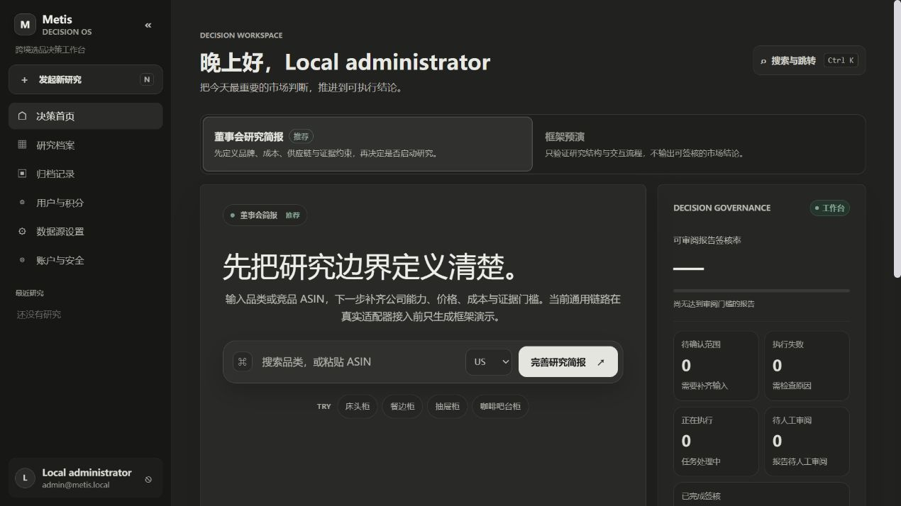
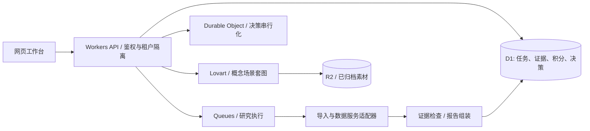

# Metis VOC

[使用 Codex 开发：工程案例说明](docs/CODEX_BUILD_CASE_STUDY.md)

**从市场证据到产品决策的跨境选品研究工作台。**

Metis 将研究任务、市场数据、VOC、产品概念、策略框架、人工审核和决策记录放在同一流程中。适合品牌产品经理、选品分析师，以及希望扩展数据源和研究 Agent 的开发者。

这是可自行部署的应用源码，不包含原运营站账号、数据库、商业数据授权或模型额度。默认关闭付费调用；示例仅用于理解结构，不能替代真实调研。

[快速开始](docs/QUICKSTART.md) · [部署](docs/DEPLOYMENT.md) · [架构与业务闭环](docs/ARCHITECTURE.md) · [数据来源](docs/DATA_SOURCES.md) · [功能边界](docs/LIMITATIONS.md) · [English](README.en.md)



## 可以用来做什么

| 场景 | 当前能力 | 需要准备 |
| --- | --- | --- |
| 搭建自己的研究工作台 | 用户、租户、积分流水、研究任务、报告阅读和版本化决策 | Node.js；上线需 Cloudflare 资源 |
| 分析市场与竞品 | 美国站猫窝 KeepaMore 文件导入；配置 API 后执行批量采集与去重 | 自己有权使用的数据或 API 额度 |
| 构建系统化研究报告 | 62 个模块的参考框架，STP、JTBD、BCG、消费者心理和旅程等 | 真实证据；缺数据模块应显示待补证据 |
| 从 VOC 推导产品方案 | 证据、需求、设计约束和概念方案关联 | 有授权的评论正文，不是评论总数 |
| 制作产品概念场景套图 | Lovart 任务、费用确认、归档、素材采纳 | 可用的服务账号、额度和 R2 |
| 交付可追溯结论 | 报告快照、审核检查、决策记录、JSON/Markdown 与浏览器 PDF | 审核和证据门禁通过 |
| 二次开发 | TypeScript 主应用、测试、接口边界及独立 Python 数据管道草案 | 阅读架构和适配器说明 |

报告支持完整参考版式，但“332 页参考分页计划”不是每次研究必须产生的有效信息量。结构完整、渲染正常、证据充分是三个不同的验收条件。

## 五分钟启动

使用 **Node.js 24 LTS** 和 **pnpm 11.19.0**。Windows PowerShell、macOS、Linux 均使用同一组命令：

```sh
git clone https://github.com/Linxiushen/metis-voc.git
cd metis-voc
corepack enable
corepack prepare pnpm@11.19.0 --activate
pnpm install --frozen-lockfile
pnpm setup:local
pnpm dev
```

打开终端显示的本地 URL。初始管理员凭据保存在被 Git 忽略的 `.local/admin-credentials.json`。没有公共默认密码。`setup:local` 不会重置已有安装。

本地开发通过 Cloudflare 模拟器提供 D1 等绑定，不要求先登录 Cloudflare。首次安装需要从包源下载依赖。详见[逐步使用说明](docs/QUICKSTART.md)。

## 架构



前端由 vinext/React 应用壳加载 Preact 工作台；Worker 承载 HTTP、Queue 和定时恢复。D1 是运行时数据源。源码中的 Python `research-kit` 是独立适配器设计草案，不是已经接入网页的生产数据中台。

## 工程检查

```sh
pnpm check          # lint、类型、测试、报告结构审计、生产构建
pnpm audit:source   # 密钥、个人信息、发布文件边界检查
pnpm audit         # 锁文件依赖漏洞审计
pnpm test:smoke    # 构建后，以独立本地 D1 运行真实 API 冒烟
```

`pnpm test:load` 是本地基线工具，不代表云上吞吐承诺。生产容量需要在目标 Cloudflare 套餐、真实数据量和上游配额下独立验证。

## 目录

```text
app/                 React 外壳和 API 路由
public/              Preact 工作台、图表、样式、合成样例
lib/                 数据、鉴权、积分、研究、证据、决策、概念图
worker/              Worker / Queue / Scheduled 入口
db/ + drizzle/       Schema 定义和历史结构迁移
tests/               API、真实 SQLite、并发恢复与内容回归
scripts/             初始化、检查、构建、压力基线与离线阅读版工具
research-kit/        可选 Python 数据适配器草案
docs/                使用、部署、架构、数据与运维说明
```

## 开源与贡献

原创代码和原创合成样例采用 [MIT](LICENSE)。第三方软件、市场来源页面、商标和外部 API 内容按各自条款使用，详见 [THIRD_PARTY_NOTICES.md](THIRD_PARTY_NOTICES.md)。本发布包没有原站数据和历史 Git 凭据。

欢迎通过 Issue 反馈可复现问题，通过 PR 改进适配器、报告质量和交互。提交前阅读 [CONTRIBUTING.md](CONTRIBUTING.md)；敏感漏洞请按 [SECURITY.md](SECURITY.md) 私下报告。
