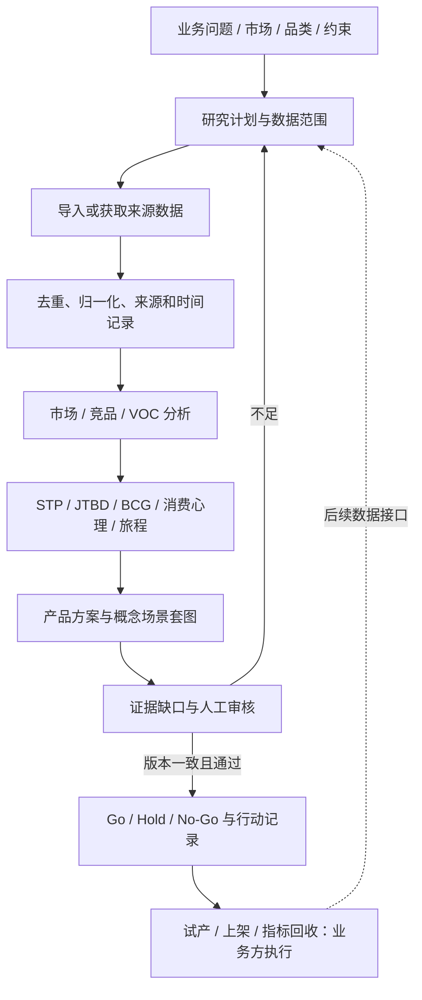

# 技术架构与业务闭环

## 业务流程

系统已提供研究到人工决策的记录链路。试产、ERP、广告、订单、退货和财务指标回流需要对接，不能将“记录了决策”描述成已经自动完成全经营闭环。

## 模块职责

| 层 | 代码 | 职责 |
| --- | --- | --- |
| 网页 | `app/`、`public/app.js`、`public/reference-deck.js` | React 外壳、Preact 工作台、报告阅读和交互 |
| HTTP | `app/api/[[...path]]/route.ts` | 校验、鉴权、租户边界、状态更新、导出 |
| 入口 | `worker/index.ts` | API Origin 门禁、观测、Queue、定时恢复 |
| 身份 | `lib/auth.ts` | PBKDF2 密码、随机会话、数据库仅存令牌摘要 |
| 存储 | `lib/database.ts`、`db/` | D1 运行时表、兼容迁移和空安装 bootstrap |
| 计费 | `lib/credits.ts` | 业务幂等键、扣款/退款流水和并发保护 |
| 研究执行 | `lib/research-queue.ts` | Queue 执行、租约、重试、终态与恢复结算 |
| 数据 | `lib/keepamore*.ts`、`lib/voc-evidence.ts` | 导入/API契约、证据组织、数据质量边界 |
| 报告 | `lib/board-reports.ts`、`lib/board-framework-v2.ts` | 参考框架组装、策略与展示契约 |
| 决策 | `lib/decision-coordinator.ts` | 同一研究的决策写入协调、避免竞争覆盖 |
| 概念图 | `lib/lovart.ts` | 任务确认、下载边界、异步归档、素材验证 |

## 状态与一致性

任务创建后先形成可检查的研究计划；确认执行时，创建者身份、积分和任务状态共同决定是否入队。只有任务创建者可以确认执行，避免 API 扣操作者、Queue 扣创建者的归属不一致。

队列按执行 token 和租约领取任务。租约接管必须在原子数据库条件中验证到期时间。过时 worker 不得覆盖新执行者状态，也不得替新执行者退款。终态失败先落库；恢复任务只补齐结算，不重新调用收费服务。

积分流水按业务键重放。重试使用原始扣款，规则调价或停用不改变既有流水。退款必须关联真实原扣款，并且最多成功补偿一次；已退款尝试不能直接继续成功。

报告、审核、概念素材和导出绑定版本/摘要。更新报告后，旧审核不能继续证明新内容已审；导出前重新校验，避免将未审核修改作为正式结论。

## 数据含义

商品快照、评论正文、分析结论、人工假设和示例记录是不同对象。字段至少应保留来源、采集时间、市场、单位、样本分母及是否估算。示例文件的 `synthetic_fixture` 和 `insufficient_evidence` 用来避免演示数据进入真实决策链。

BCG 需要相对市场份额和市场增长率；缺任一项时只能提供待验证的布局，不能用评分或搜索排序冒充市场份额。消费者心理/JTBD 是解释框架，需要可回溯 VOC 或访谈支持。工程约束需要供应链或测试报告验证，概念图不承担证明作用。

## 部署边界

运行时需要 Cloudflare 绑定，不能仅将 `dist/client` 放到静态空间获得完整功能。生产 Worker、D1、Queues、Durable Objects 属于自己的账号；R2 按需启用。配置与秘密分离，前端仅访问同源 `/api`，不指向任何原运营域名。

`research-kit/` 为可选研究草案：SP-API、Keepa、DataForSEO 等适配器仍含 TODO。它不在主应用的 HTTP/Queue 链路中，新增数据服务应通过可测试的适配器显式接入。
