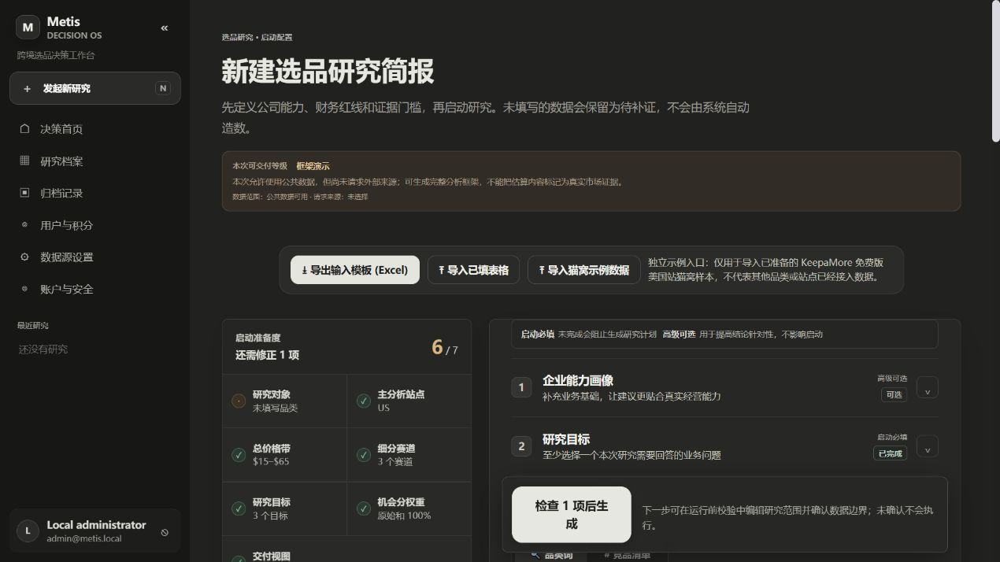

# 本地安装与使用

## 1. 安装

推荐 Node.js 24 LTS、pnpm 11.19.0；使用 lockfile，避免自行混用 npm/yarn 锁文件。若系统没有 Corepack，可先安装 pnpm 的指定版本。

```sh
pnpm install --frozen-lockfile
pnpm setup:local
pnpm dev
```

打开命令行显示的 URL。默认仅绑定 `127.0.0.1`。D1 的本地数据由 Cloudflare 开发工具保存在 `.wrangler/`；不是远端生产库。启动前应执行 `setup:local`；已有注册用户的安装不会再创建配置中的 bootstrap 管理员。

初始化会创建 `.dev.vars` 和 `.local/admin-credentials.json`，其中包含随机加密密钥及管理员凭据。用文件中的账号登录；不要提交或分享这些文件。再次运行初始化不会覆盖它们。

管理员 bootstrap 只针对完全没有用户的安装；更换环境变量不会修改已有账户密码。生产环境应使用自己的管理员和独立密钥。

## 2. 无 API 额度时能做什么

登录后先了解任务列表、研究输入、报告、数据来源、设置、积分和用户管理。可创建研究任务、检查研究计划，再确认执行。未接入真实数据时，结果属于模板/待补证据，不应进入正式签核。



若需要查看五种家具品类的完整参考框架，请在新建空白测试环境中执行 `setup:local` 后、首次启动前，将本地 `.dev.vars` 中的 `ENABLE_EXAMPLE_REPORTS=false` 改为 `true`。示例只在数据库首次初始化时写入；已初始化的数据库不会因修改开关并重启而补写示例。需要体验时可另建一个全新的测试副本，保留现有数据。只在自己的测试环境使用。示例的 VOC 是原创合成数据；图片是原创示意图；市场链接是历史参考，不代表实时刷新。

## 3. 导入自己的市场数据

当前网页免费导出导入入口仅支持 **Amazon US / USD / cat bed（猫窝）** 的 KeepaMore CSV/XLSX，并非任意品类。使用自己有权导出的文件和明确来源元数据。多批 JSON 可先通过 `scripts/merge-keepamore-batches.mjs` 合并成 CSV、按商品标识去重；JSON 不是网页上传格式。其他品类/市场需扩展解析和研究映射，不能只改文件标签。

数据量以去重后的有效商品/评论为准。重复请求同一页不会增加有效样本；商品的评论总数也不是已取得的评论正文数。导入后检查覆盖范围与缺失字段，再解释价格、竞争和需求信号。

## 4. 接入 API

阅读 [数据源说明](DATA_SOURCES.md)，在租户设置保存自有 Key。密钥在服务端加密保存，页面只返回掩码。全局 `PAID_PROVIDER_CALLS_ENABLED` 默认关闭，需运营者明确开启。平台共享 Key 另有套餐门禁；试用租户使用自有 KeepaMore Key 仍需全局开关开启。

LLM 负责分析和结构化输出，不能凭模型生成真实销量或评论。概念图是设计提案，不是工程图、认证结论或制造许可。

## 5. 阅读、审核与导出

先查看结论摘要与证据状态，再查看市场/VOC、策略、产品约束、消费者旅程、概念套图和行动清单。沿来源 ID 检查关键数值和引用。数据缺口应保留为待办。

JSON/Markdown 导出与正式交付受状态和报告版本约束。网页“打印 / 保存为 PDF”使用浏览器打印能力。服务端 `export.pdf`、`export.pptx` 及飞书导出尚未实现，不能当成已上线功能。

## 常见问题

| 现象 | 检查方法 |
| --- | --- |
| 页面能开，接口不能用 | 用 `pnpm dev` 或本地 Worker 预览；直接打开静态 HTML 没有 D1/API |
| 管理员登录失败 | 查看本机凭据文件；bootstrap 不会重置已经存在的用户 |
| 列表为空 | 新安装默认没有商业报告；创建任务或显式启用示例 |
| API 有 Key 却不能执行 | 检查服务订阅、额度、全局付费开关、租户权限和运行就绪提示 |
| 任务卡住 | 检查 Queue 绑定、错误日志、租约与定时恢复；不要手动重复扣款 |
| 无法正式审核 | 检查证据状态、待补项目和报告版本；页数完整不等于证据充分 |
| 概念图不可用 | 检查 Lovart、R2、归档 Queue 及可公开下载的 HTTPS 图片地址 |

在全新本地临时环境验证安装链路：先 `pnpm build`，再 `pnpm test:smoke`。它不连接原运营站。
